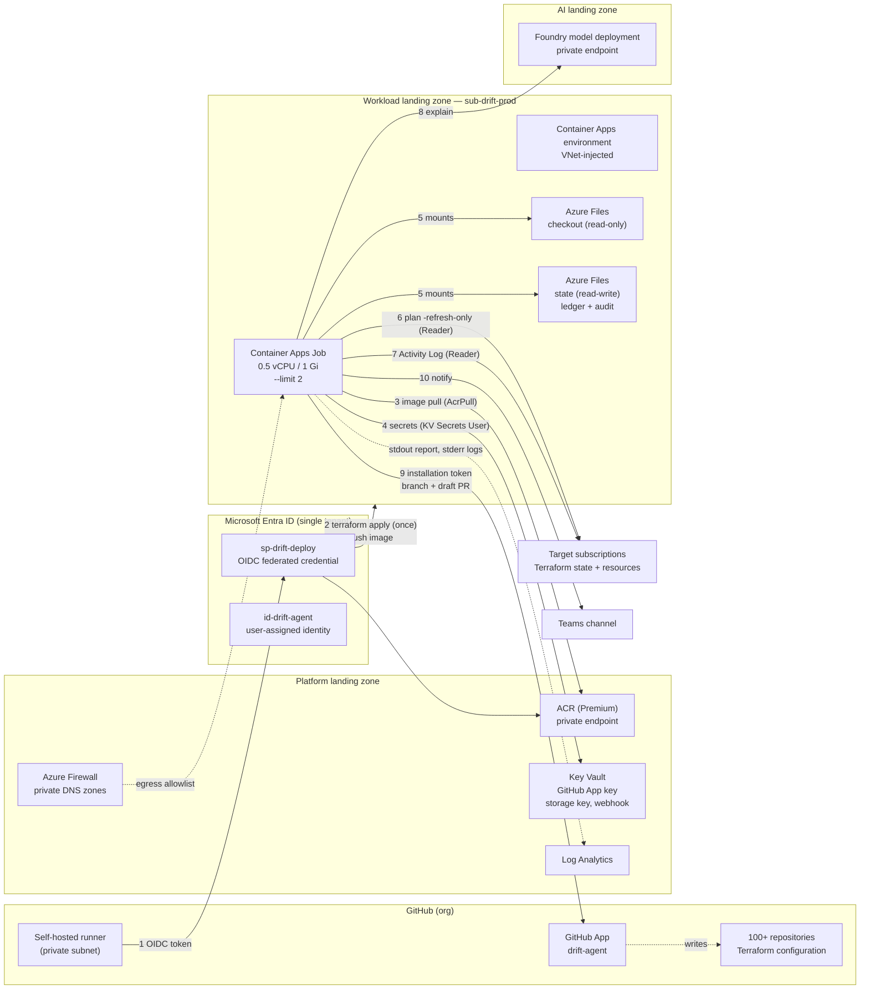
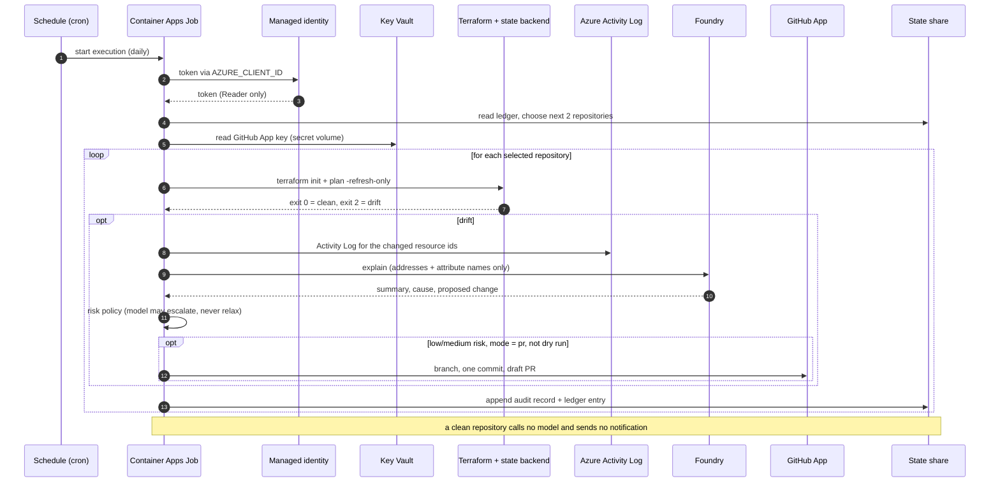

# Azure architecture — drift agent in an Azure Landing Zone

Target design for a **single-tenant, private-egress** deployment, built with the
AVM-based Azure Landing Zones modules (`Azure/avm-ptn-alz/azurerm` and its
siblings), which replace the deprecated `Azure/terraform-azurerm-caf-enterprise-scale`
module. Everything here is a design to agree with your platform team; nothing in
this document has been applied to a real subscription.

Contents: [placement](#1-where-it-sits) ·
[components](#2-components) ·
[identities](#3-identity-model) ·
[GitHub App vs OIDC](#4-github-app-vs-oidc) ·
[network](#5-network) ·
[policy](#6-landing-zone-policy-interactions) ·
[data flow](#7-one-execution-end-to-end) ·
[cost](#8-cost) ·
[blast radius](#9-blast-radius-and-failure-modes) ·
[decisions](#10-decisions-to-confirm)

---

## 1. Where it sits

| Layer | Subscription | What lives there |
| --- | --- | --- |
| Platform landing zone | `sub-platform-*` | Hub VNet, Azure Firewall, private DNS zones, shared ACR, Key Vault, Log Analytics workspace |
| **Workload landing zone** | **`sub-drift-prod`** (new, under `landing-zones`, **Corp** archetype) | Container Apps environment, the drift job, its managed identity and role assignments, its own storage account/shares |
| AI landing zone | `sub-ai-*` (existing, holds Foundry) | The existing Foundry project and model deployment, reached over private endpoint |
| Target estate | every subscription that owns Terraform-managed resources | Nothing is deployed here; the job only reads |

**Why a workload landing zone and not platform:** the agent is a workload with a
Corp networking profile (private egress, UDR to the firewall, private endpoints).
Platform subscriptions are for shared connectivity/identity/management services.

**Why not one subscription per scanned repo:** the registry already carries
`azure_subscription_id` per repository, so one job can scan many subscriptions.
Deploy once, scan everywhere.

---

## 2. Components



| Node | Created by | Notes |
| --- | --- | --- |
| Container Apps environment | **ALZ / sub-vending**, not this repo | VNet-injected; this repo's module takes its id as an input |
| Container Apps Job + identity + role assignments + storage registrations | `deploy/terraform/` (this repo) | The only thing this repo provisions |
| Storage account + shares | Platform team or `avm-ptn-alz-sub-vending` | Checkout share read-only, state share read-write |
| ACR, Key Vault, Log Analytics, firewall, DNS | Platform team | Reference them by id/name |
| Foundry + model deployment | Existing AI landing zone | Never created by this module |
| GitHub App | Org admin, once | See [§4](#4-github-app-vs-oidc) |
| Self-hosted runners | ALZ CICD bootstrap (`avm-ptn-alz-application-landing-zone-cicd-bootstrap-github`) or your existing runner pool | Needs ACR push access and private endpoint reachability |

---

## 3. Identity model

Three identities, three different jobs. Conflating them is the usual source of
"why can't the job open a PR" and "why does the pipeline need Contributor".

| Identity | Type | Authenticates to | Permissions | Lifetime |
| --- | --- | --- | --- | --- |
| `sp-drift-deploy` | Entra app registration + service principal | **Azure**, from GitHub Actions via OIDC federated credential | `Contributor` on the job resource group; `AcrPush` on ACR; `Key Vault Secrets User` on the secrets vault (to read the storage key for tfvars) | Short-lived token per workflow run, no stored secret |
| `id-drift-agent` | User-assigned managed identity | **Azure** (job runtime) | `Reader` on the target scopes (management-group or per-subscription); `Key Vault Secrets User`; `AcrPull` | Managed by Azure, no credential to rotate |
| `drift-agent` | GitHub App installation | **GitHub** (job runtime) | Metadata read; Contents read/write; Pull requests read/write, on selected repositories only | 1-hour installation token, minted per run |

Where the secrets live:

| Secret | Store | Read by |
| --- | --- | --- |
| GitHub App private key (PEM) | Key Vault secret `github-app-private-key` | Job, via Key Vault secret volume (`/var/run/secrets/github`) |
| Checkout storage account key | Key Vault secret | Deploy pipeline only (environment storage registration needs a key) |
| Teams webhook URL | Key Vault secret | Job, as a Container Apps secret reference |
| Foundry API key | Only if managed identity is impossible | Job, as a secret reference |

**Runtime never holds an Azure write role.** `Reader` on the target scopes plus
Key Vault read is the entire Azure permission set. That is what makes "the agent
cannot apply anything" an architectural property rather than a code convention —
on top of the code-level command allowlist that refuses `apply`/`destroy`.

---

## 4. GitHub App vs OIDC

These two are orthogonal and frequently confused, so explicitly:

| | OIDC federated credential | GitHub App |
| --- | --- | --- |
| Direction | GitHub → **Azure** | Job → **GitHub** |
| Question it answers | "Is this really our repo's workflow?" | "Which repositories may this agent write to?" |
| Used by | The deploy pipeline | The runtime job |
| Credential | None stored; short-lived token exchange | App private key in Key Vault → 1h installation token |
| Azure role | `Contributor` on the job RG | None |

The agent runs in an Azure job, **not** inside a GitHub Actions workflow, so
`GITHUB_TOKEN` (the ephemeral token Actions injects) does not exist for it, and a
personal access token would be a long-lived credential tied to a person. The
GitHub App is the only mechanism that gives an external workload tightly scoped,
short-lived, org-owned, auditable write access to repositories.

Federated credential subject formats to choose from:

| Subject | Use |
| --- | --- |
| `repo:<org>/<repo>:ref:refs/heads/main` | Deployments only from `main` (simplest) |
| `repo:<org>/<repo>:environment:prod` | Deployments from a protected GitHub Environment (recommended) |
| `repo:<org>/<repo>:pull_request` | Plan-only validation on PRs |

Issuer `https://token.actions.githubusercontent.com`, audience
`api://AzureADTokenExchange`.

**Multi-org limitation (honest gap):** the client uses one `GITHUB_APP_INSTALLATION_ID`,
so all registry repositories must belong to the same GitHub org (or GHES
instance). Repositories spread across several orgs need either one job per org or
an extension that resolves the installation per repository.

---

## 5. Network

### Subnets (consumed from the workload VNet that ALZ/sub-vending creates)

| Subnet | Size | Delegation | Purpose |
| --- | --- | --- | --- |
| `snet-aca-env` | `/23` | `Microsoft.App/environments` for a workload-profile environment; none for Consumption-only | Environment infrastructure. **Cannot be resized later** |
| `snet-private-endpoints` | `/27`–`/24` | none | Private endpoints for ACR, Key Vault, Storage, Foundry |
| `snet-runners` | `/27`–`/24` | depends on runner host (ACI/ACA/VMSS) | Self-hosted GitHub runners |

Azure's rules, verified against the Container Apps VNet documentation: workload
profile environments need a subnet delegated to `Microsoft.App/environments`, and
the minimum subnet size is `/27`; Consumption-only environments must not be
delegated and the subnet must be between `/23` and `/12`. Plan `/23` regardless —
it is the one decision you cannot change afterwards.

### Private endpoints

| Resource | Private DNS zone | Reached by |
| --- | --- | --- |
| Azure Container Registry | `privatelink.azurecr.io` | Job image pull, runner push |
| Key Vault | `privatelink.vaultcore.azure.net` | Job (secret volume + SDK) |
| Storage (blob + file) | `privatelink.blob.core.windows.net`, `privatelink.file.core.windows.net` | Container Apps environment storage mount |
| Foundry / AI Services | `privatelink.services.ai.azure.com`, `privatelink.cognitiveservices.azure.com`, `privatelink.openai.azure.com` (confirm which your deployment uses) | Job explain stage |

ALZ usually links these zones to the workload VNet through a `DeployIfNotExists`
policy, so they appear automatically — verify rather than assume, because a
missing zone link presents as an intermittent `403` or a timeout.

### Egress allowlist (firewall / UDR path)

The job's subnet routes through the firewall. `terraform init` needs a provider
registry; the rest is private endpoint traffic.

| Destination | Why | Alternative |
| --- | --- | --- |
| `registry.terraform.io` | Provider discovery | **Provider mirror** (preferred) |
| `releases.hashicorp.com`, `objects.githubusercontent.com` | Terraform binary/provider downloads | Bake providers into the image |
| `github.com`, `codeload.github.com` | Module sources, if the configs use them | Internal module registry |
| `api.github.com` (or your GHES URL) | Draft PR creation | Must be allowlisted; no private endpoint exists |
| `management.azure.com`, `login.microsoftonline.com` | ARM + token acquisition | Service tags: `AzureCloud`, `AzureActiveDirectory` |
| `graph.microsoft.com` | Optional Graph mail notifier | Omit if Teams-only |

**Preferred over allowlisting:** seed a provider mirror on the state share and
point Terraform at it, which removes `registry.terraform.io` and
`releases.hashicorp.com` from the runtime path entirely:

```hcl
# .terraformrc, mounted into the container
provider_installation {
  filesystem_mirror {
    path    = "/state/tf-mirror"
    include = ["registry.terraform.io/*/*"]
  }
  direct { exclude = ["registry.terraform.io/*/*"] }
}
```

### Key Vault caveat

Container Apps resolves Key Vault-backed secrets **on the platform side**, not
inside your container. If the vault has public network access disabled, the
environment needs the vault's "Allow trusted Microsoft services to bypass this
firewall" exception, or the secret volume fails even though the identity has
`Key Vault Secrets User`. Test this before locking the vault down completely.

---

## 6. Landing zone policy interactions

Check these assignments in the workload management group before applying:

| Policy / archetype behaviour | Effect on this deployment |
| --- | --- |
| Deny public IPs, require private endpoints | Compatible: no public ingress, all endpoints private |
| "Container registries should use private link" | Forces **ACR Premium** (~$50/month) — reuse the platform ACR instead of creating one |
| Storage: disable public network access | Compatible; the environment storage registration uses the account key over the private endpoint |
| Key Vault: purge protection, private endpoint, no public access | Compatible, with the trusted-services caveat above |
| Allowed locations | Pick a region that supports Container Apps **and** is reachable to the Foundry private endpoint |
| Deny `Microsoft.App/*` (some regulated archetypes) | Needs a scoped, time-bound policy exemption at the job resource group |
| Require diagnostic settings / Log Analytics | Container Apps environment already forwards console logs; confirm the destination |

`Microsoft.App` and `Microsoft.OperationalInsights` resource providers must be
registered on the workload subscription.

---

## 7. One execution, end to end



Everything the job writes outside Azure is one draft PR per validated patch; it
never merges, never pushes to a default branch, and never touches Azure
resources.

---

## 8. Cost

| Item | Monthly |
| --- | --- |
| Container Apps Job compute (2 repos/day, 0.5 vCPU, 1 GiB) | $0 — inside the 180,000 vCPU-s / 360,000 GiB-s free grant |
| Job compute at 100 repos/day, every day (worst case) | ≈ $1.35 |
| Azure Files (few GiB, transaction-optimised) | cents |
| Log Analytics ingestion (kilobytes per run) | cents |
| ACR | **reuse the platform Premium registry**; a new Basic is ~$5/month and a new Premium ~$50/month |
| Container Apps environment | free in Consumption-only; **a dedicated workload profile bills 24/7** |

The dominant risk is not the job — it is standing up a new Premium ACR or
running the job on dedicated capacity.

---

## 9. Blast radius and failure modes

| Failure | Consequence | Mitigation |
| --- | --- | --- |
| Foundry unavailable | Drift still detected, explained by fallback text | Recorded as `analysis.source = fallback`; scan does not fail |
| Azure Activity SDK/credential missing | Drift still detected without actor evidence | `azure_activity` empty, reason logged |
| GitHub App misconfigured | No PR; finding still audited and notified | `remediation.status` stays `validated`, reason recorded |
| Registry entry points at a bad path | One repository errors, the rest of the batch continues | Per-repo `error` record, ledger still advances |
| Job killed mid-batch | Findings already written stay; ledger reflects finished repos only | Ledger written after every repository |
| Compromised job identity | Read-only Azure access, plus draft-PR creation in allowlisted repos | No Azure write role exists; PRs are drafts and reviewed |
| State share unwritable | Ledger cannot persist, rotation repeats | Job logs `fleet_state_not_saved`; alert on that event |

---

## 10. Decisions to confirm

1. **Is Container Apps permitted** in your workload archetype, or is a policy exemption needed?
2. **ACR**: reuse the platform Premium registry (recommended) or create one?
3. **Environment type**: Consumption-only (cheapest, subnet `/23`, no delegation) or workload profiles (delegated subnet, dedicated cost)?
4. **Reader scope**: one assignment at the landing-zones management group, or per target subscription (more granular audit, more assignments)?
5. **Runner placement**: existing runner pool vs the ALZ CICD bootstrap module, and does it already reach the private endpoints?
6. **Repository ownership**: everything in one GitHub org? If not, see the multi-org limitation in §4.
7. **Tenant scope**: single tenant is assumed. Cross-tenant scanning is not implemented — `AZURE_TENANT_ID` is process-wide while subscriptions are per repository.
